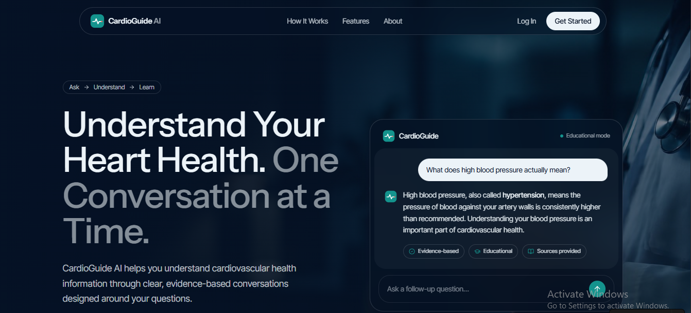
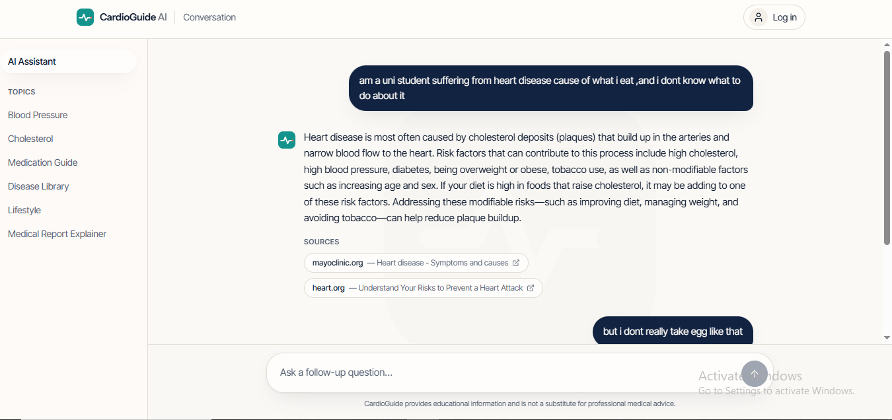
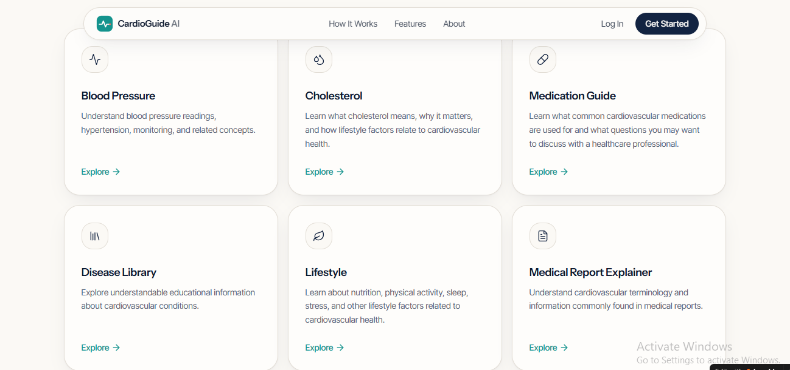
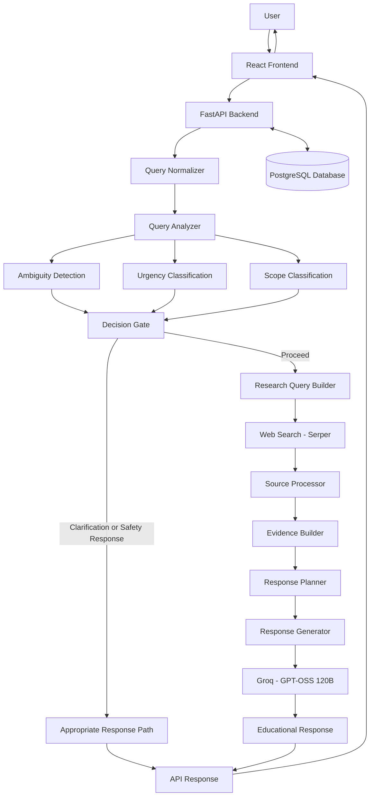

# CardioGuide AI ❤️

### Understand your heart health, one conversation at a time.

**CardioGuide AI is an AI-powered cardiovascular health education assistant. It makes reliable heart-health information easier to understand through natural conversation, web-supported research, evidence-grounded answers, and safety-aware question handling.**

<p align="center">
  <a href="https://cardio-guid.lovable.app/">
    
  </a>
  <a href="https://cardio-guide-ai.onrender.com/health">
    
  </a>
</p>

<p align="center">
  <a href="https://cardio-guid.lovable.app/">Live Application</a> ·
  <a href="https://cardio-guide-ai.onrender.com">Backend API</a> ·
  <a href="https://cardio-guide-ai.onrender.com/docs">API Docs</a> ·
  <a href="CARDIOGUIDE_BACKEND_SPEC.md">Backend Spec</a> ·
  <a href="https://github.com/Rbolarinwa-DS">GitHub Profile</a>
</p>

<p align="center">
  
  
  
  
  
  
</p>

> **Medical disclaimer:** CardioGuide AI is an educational project, not a medical device. It does not diagnose, treat, or replace professional medical care. In an emergency, contact your local emergency services immediately.

---

## Table of Contents

- [Live Demo and Screenshots](#live-demo-and-screenshots)
- [Project Overview](#project-overview)
- [The Problem](#the-problem)
- [Project Objectives](#project-objectives)
- [Key Features](#key-features)
- [How It Works](#how-it-works)
- [System Architecture](#system-architecture)
- [Technology Stack](#technology-stack)
- [Backend API](#backend-api)
- [Database and Conversation Persistence](#database-and-conversation-persistence)
- [Project Structure](#project-structure)
- [Getting Started](#getting-started)
- [Environment Variables](#environment-variables)
- [Running with Docker](#running-with-docker)
- [Testing](#testing)
- [Safety, Scope, and Limitations](#safety-scope-and-limitations)
- [Current Project Status](#current-project-status)
- [Future Improvements](#future-improvements)
- [Author](#author)

---

## Live Demo and Screenshots

**[Launch CardioGuide AI →](https://cardio-guid.lovable.app/)**

A conversational frontend connects to a Python backend that handles question analysis, web research, evidence processing, language-model generation, and response delivery.

| Service | Link |
|---|---|
| Frontend | [cardio-guid.lovable.app](https://cardio-guid.lovable.app/) |
| Backend API | [cardio-guide-ai.onrender.com](https://cardio-guide-ai.onrender.com) |
| Health check | [/health](https://cardio-guide-ai.onrender.com/health) |

A reachable frontend does not guarantee that every backend dependency or AI request is working.

### 1. Landing page

The landing page introduces CardioGuide AI and its focus on accessible cardiovascular health education.



### 2. Conversational AI interface

The chat interface is the main experience for asking cardiovascular health questions and receiving educational answers.



### 3. Additional application view



---

## Project Overview

CardioGuide AI is a conversational AI project focused on cardiovascular health education.

Rather than sending each question straight to a language model, the backend runs a research and response pipeline. It analyzes the question, determines intent and scope, builds research queries, retrieves information from the web, organizes the evidence, and then generates an educational answer. Safety checks run alongside this to separate routine questions from ambiguous or potentially urgent ones.

The aim is an AI application that is more structured, explainable, and maintainable than a basic chatbot.

**The project combines:**

- **Natural language processing** to interpret informal, misspelled, or medically phrased questions
- **Information retrieval** to turn questions into search queries and fetch relevant web results
- **Evidence processing** to organize retrieved material before generation
- **Large language models** to write clear, conversational explanations
- **Safety-aware routing** to assess scope and urgency before proceeding
- **Backend engineering** with a FastAPI service
- **Database integration** for user and conversation data
- **Deployment** of a hosted frontend, a separate backend, and a managed database

---

## The Problem

Cardiovascular information is easy to find but hard to interpret. Users run into:

- Medical terminology that is difficult to follow
- Information scattered across many websites
- Conflicting or poorly contextualized health claims
- Chatbot answers that don't separate evidence from generated text
- Difficulty recognizing when a question describes something urgent

A typical chatbot gives fluent answers that may not be grounded in sources. A search engine returns pages but leaves the interpretation to the user. CardioGuide AI sits between the two: conversational interaction backed by a structured research workflow and explicit safety considerations.

## Project Objectives

1. Make cardiovascular health education more accessible through natural conversation
2. Interpret user questions carefully before research begins
3. Retrieve relevant information for supported questions through web search
4. Organize retrieved material into evidence that supports the answer
5. Generate understandable answers within the educational scope of the application
6. Route ambiguous and potentially urgent questions safely
7. Provide a backend that can be tested, maintained, and extended
8. Persist conversations in a relational database
9. Demonstrate how AI, retrieval, APIs, databases, and deployment fit together in one application

---

## Key Features

- **Conversational education:** Ask about blood pressure, risk factors, symptoms, prevention, and general heart health in plain language.
- **Query normalization:** Standardizes misspellings, abbreviations, and informal wording before analysis. It prefers deterministic rules and uses the language model only where needed, and it must not silently change an important medical detail.
- **Intent and topic analysis:** Separates general explanations, symptom questions, and questions that need clarification or urgent guidance.
- **Research query construction:** Rewrites the user's wording into search-oriented queries, keeping conversation and retrieval separate.
- **Web-supported research:** Uses Serper to retrieve results. Retrieved does not mean authoritative, so source quality still matters.
- **Evidence construction:** Organizes material on symptoms, causes, risk factors, diagnosis, complications, prevention, treatment, monitoring, lifestyle, and when to seek medical help. Which topics appear in an answer depends on the evidence found.
- **Evidence-grounded generation:** Uses Groq-hosted GPT-OSS 120B to turn processed evidence into a clear answer. Keeping generation separate from research and safety logic makes each stage easier to test and improve.
- **Safety-aware decision-making:** Components evaluate ambiguity, urgency, and scope, and a decision gate chooses how each request proceeds. This supports safer routing but does not guarantee that every emergency is detected.
- **Persistent conversations:** PostgreSQL stores users, conversations, and messages. Stored history is not automatically passed to the model in later turns.
- **REST API:** FastAPI exposes the backend so the frontend and backend can be developed, tested, and deployed independently.
- **Deployable architecture:** Hosted frontend, separately hosted backend, managed PostgreSQL, and a Dockerfile for a reproducible backend environment.

---

## How It Works

Each stage has a single responsibility.

1. **Submit:** The frontend sends the user's question to the backend API.
2. **Normalize:** The query normalizer standardizes wording while preserving meaning.
3. **Analyze:** The query analyzer evaluates intent and topic, while related components assess scope, ambiguity, and urgency.
4. **Route:** The decision gate chooses a path. Questions needing clarification or urgent guidance are not treated as ordinary research requests.
5. **Build queries:** The research query builder prepares search queries.
6. **Retrieve:** The web searcher uses Serper to fetch results.
7. **Process sources:** The source processor prepares the retrieved material.
8. **Build evidence:** The evidence builder organizes relevant information, and the response planner decides how it supports the answer.
9. **Generate:** The response generator writes the answer with the configured language model.
10. **Deliver:** The backend returns the result to the frontend.

Not every request runs every stage. The path depends on the safety and decision components.

---

## System Architecture



*Logical overview. The implementation determines the exact order and dependencies.*

### Responsibilities

| Component | Responsibility |
|---|---|
| Query normalizer | Standardize user wording |
| Query analyzer | Interpret the question and its likely intent |
| Ambiguity detector | Identify questions that need clarification |
| Urgency classifier | Evaluate signals of potential urgency |
| Scope classifier | Check that a request fits the application's purpose |
| Decision gate | Route the request based on the analysis |
| Research query builder | Prepare web-search queries |
| Web searcher | Retrieve potentially relevant web results |
| Source processor | Prepare retrieved source material |
| Evidence builder | Organize supporting evidence |
| Response planner | Structure the intended answer |
| Response generator | Write a readable response from the supplied material |
| FastAPI application | Expose functionality over HTTP |
| PostgreSQL | Persist application records |

This separation makes component-level testing possible. It does not by itself make the system reliable or clinically safe.

---

## Technology Stack

| Layer | Technology | Purpose |
|---|---|---|
| Frontend | React, TypeScript, Tailwind CSS | Component-based, typed, styled interface |
| Frontend | Lovable | Development and hosting workflow |
| Backend | Python, FastAPI, Uvicorn | API and orchestration |
| AI | Groq, GPT-OSS 120B | Hosted language-model inference |
| Research | Serper | Web search |
| Data | PostgreSQL on Neon, SQLAlchemy | Relational storage and ORM |
| Data | Alembic | Database migrations |
| Deployment | Docker, Render | Containerized backend and hosting |
| Tooling | Git, GitHub | Version control |

Check the repository's dependency files for exact versions.

---

## Backend API

| Method | Endpoint | Purpose |
|---|---|---|
| `GET` | `/` | Root endpoint and basic application information |
| `GET` | `/health` | Health check |
| `POST` | `/chat` | Submit a question to the conversational backend |
| `GET` | `/conversations/{conversation_id}` | Retrieve a conversation |
| `GET` | `/users/{user_id}/conversations` | List a user's conversations |

### Example chat request

```http
POST /chat
Content-Type: application/json
```

```json
{
  "question": "What does high blood pressure mean?",
  "user_id": "example-user-id",
  "conversation_id": "example-conversation-id"
}
```

The identifiers are placeholders, and both are optional. A minimal request works too:

```json
{
  "question": "What is blood pressure?"
}
```

### Try the deployed API

- [Backend root](https://cardio-guide-ai.onrender.com)
- [Health check](https://cardio-guide-ai.onrender.com/health)
- [Interactive API documentation](https://cardio-guide-ai.onrender.com/docs)

A successful health check confirms only what that endpoint tests. It does not verify language-model access, web search, database operations, or emergency-handling behavior.

---

## Database and Conversation Persistence

PostgreSQL stores the application's user and conversation data, with schema changes managed through Alembic migrations.

| Data area | Purpose |
|---|---|
| Users | Associate activity with user identifiers |
| User profiles | Store supported profile information |
| Conversations | Represent individual conversation sessions |
| Messages | Store messages within conversations |

Persistence supports retrieving earlier conversations, linking messages to the right conversation, continuity across interactions, and future conversation management. The exact schema is defined in the `database/` and `alembic/` folders.

Because the app handles health-related questions, treat stored data with care. A user identifier alone should not authorize someone to read another user's conversations, so access controls, logging, and retention need to be designed with privacy in mind.

---

## Project Structure

```text
Cardio-Guide-AI/
├── alembic/                       # Database migrations
├── api/                           # FastAPI application and schemas
├── data/                          # Data files used by the application
├── database/                      # Database models and connection
├── pictures/                      # Screenshots used in this README
├── query_engine/                  # Normalization, analysis, research, evidence, safety, generation
├── CARDIOGUIDE_BACKEND_SPEC.md    # Backend design specification
├── Dockerfile                     # Backend container image
├── .dockerignore
├── .gitignore
├── LICENSE
└── README.md
```

Your local `.env` file holds real credentials and must stay out of Git.

---

## Getting Started

### Prerequisites

- Python 3.11 or a compatible version
- Git
- A PostgreSQL database for the application
- A [Groq](https://groq.com/) API key
- A [Serper](https://serper.dev/) API key

Running the backend locally does not start the hosted frontend.

### 1. Clone the repository

```bash
git clone https://github.com/Rbolarinwa-DS/Cardio-Guide-AI.git
cd Cardio-Guide-AI
```

### 2. Create a virtual environment

**Windows PowerShell**

```powershell
python -m venv .venv
.\.venv\Scripts\Activate.ps1
```

**macOS or Linux**

```bash
python3 -m venv .venv
source .venv/bin/activate
```

### 3. Install dependencies

```bash
python -m pip install --upgrade pip
python -m pip install -r requirements.txt
```

### 4. Configure environment variables

Create a `.env` file in the project root:

```dotenv
DATABASE_URL=your_postgresql_connection_string
GROQ_API_KEY=your_groq_api_key
SERPER_API_KEY=your_serper_api_key
```

These are placeholders, not working credentials.

### 5. Apply database migrations

```bash
alembic upgrade head
```

### 6. Start the backend

```bash
python -m uvicorn api.main:app --reload
```

The backend runs locally at:

- API root: `http://127.0.0.1:8000/`
- Health check: `http://127.0.0.1:8000/health`
- Interactive docs: `http://127.0.0.1:8000/docs`

If startup fails, check the error message, environment variables, dependency versions, and database connection.

---

## Environment Variables

| Variable | Purpose |
|---|---|
| `DATABASE_URL` | Connection string for the PostgreSQL database |
| `GROQ_API_KEY` | Credential for the Groq language-model API |
| `SERPER_API_KEY` | Credential for the Serper search API |

### Security practices

- Never commit real API keys, passwords, or connection strings
- Keep `.env` in `.gitignore`
- Use separate credentials for local development and production
- Store production secrets in the hosting provider's environment settings
- Don't log secrets or full connection strings
- Rotate any credential that has been exposed

---

## Running with Docker

The repository includes a `Dockerfile` for the backend.

```bash
docker build -t cardioguide-api .
docker run --env-file .env -p 8000:8000 cardioguide-api
```

The API is then available at `http://localhost:8000`. If you use an external database such as Neon, `DATABASE_URL` in your `.env` file must point to it.

---

## Testing

Because the pipeline has many stages, testing that the server starts is not enough. Priority areas:

- **Component tests:** normalization preserves meaning, research queries are built correctly, evidence construction handles empty results, and the generator does not invent support missing from its evidence.
- **API tests:** valid requests succeed, malformed requests fail cleanly, and dependency failures don't expose secrets.
- **Integration tests:** API to pipeline, application to database, and application to the search and model providers, with provider outages kept separate from logic failures.
- **Safety regression tests:** general educational questions, misspelled medical terms, vague questions, potentially urgent symptoms, out-of-scope requests, and insufficient or contradictory evidence.

Routing potentially urgent symptoms to immediate safety guidance, instead of treating them as ordinary research questions, is the most important case to cover.

```bash
python -m pytest -v
```

Passing tests show only that the tested behavior works. They do not establish clinical validity or guarantee that every emergency is recognized.

---

## Safety, Scope, and Limitations

CardioGuide AI is built for **cardiovascular health education, not diagnosis or treatment decisions.**

- **Educational use only:** It explains concepts and helps users understand cardiovascular information. It is not a medical device.
- **No guarantee of accuracy:** Language models can be wrong, incomplete, or outdated, and web pages can be unreliable or inconsistent. A fluent answer or a cited source is not proof of correctness.
- **Emergencies:** An urgency classifier can miss warning signs. Anyone with potentially life-threatening symptoms should seek emergency care immediately instead of waiting for an AI response.
- **Evidence quality:** Answers depend on search results, source processing, and how faithfully the generator uses the evidence. When reliable evidence is missing, the system should say so instead of giving a confident answer.
- **Privacy and security:** Health conversations can be sensitive. Having a database does not establish compliance with healthcare privacy regulations.
- **Not clinically validated:** This is an engineering and AI project. Any real-world healthcare use would need clinical review, safety evaluation, privacy and security assessment, and regulatory analysis.

---

## Current Project Status

| Area | Status |
|---|---|
| Conversational frontend | Deployed on Lovable |
| Python API | Deployed on Render |
| Web-search integration | Serper |
| Language model | Groq with GPT-OSS 120B |
| Database | Neon PostgreSQL with Alembic migrations |
| Containerization | Dockerfile included |
| Query and evidence pipeline | Modular backend components |
| Safety-aware routing | Implemented, needs ongoing regression testing |
| Clinical validation | Not established |
| Production medical readiness | Not claimed |

This table describes the documented state of the project, not a live check of every service.

---

## Future Improvements

1. **Stronger evidence quality:** Source-quality scoring, source diversity, freshness checks, claim-to-source alignment, and handling of contradictions.
2. **Answer traceability:** Show which sources support which statements and catch unsupported claims before delivery.
3. **Expanded regression testing:** A repeatable evaluation set covering common questions, ambiguity, misspellings, empty search results, provider failures, and high-risk scenarios.
4. **More reliable safety routing:** Better, rigorously tested handling of urgent symptoms, with conservative behavior when information is incomplete.
5. **Conversation continuity:** Stronger retrieval, follow-up handling, ownership checks, and a clear boundary between stored history and what is passed to the model.
6. **Observability:** Structured logging, request tracing, and latency monitoring that avoid exposing credentials or retaining unnecessary sensitive data.
7. **Deployment reliability:** Automated checks, repeatable deployments, dependency management, and monitoring for external API and database failures.
8. **Expanded educational modules:** Blood pressure, cholesterol, cardiovascular disease reference, lifestyle and prevention, general medication education, and medical-report terminology.

---

## Author

**Built by Rbolarinwa-DS**, a Computer Science student exploring AI engineering, backend development, information retrieval, and practical AI applications.

- GitHub: [@Rbolarinwa-DS](https://github.com/Rbolarinwa-DS)
- Repository: [Cardio-Guide-AI](https://github.com/Rbolarinwa-DS/Cardio-Guide-AI)
- Live project: [CardioGuide AI](https://cardio-guid.lovable.app/)

---

## Disclaimer

CardioGuide AI is an educational software project. It is not intended to diagnose, prevent, treat, or cure any disease, and it does not replace professional medical advice, diagnosis, or treatment.

Information from the application may be inaccurate or incomplete. Do not delay seeking professional care because of something the application says. In a medical emergency, contact local emergency services immediately.

---

<p align="center">
  <strong>CardioGuide AI</strong><br />
  Making cardiovascular health information easier to explore, understand, and discuss.
</p>