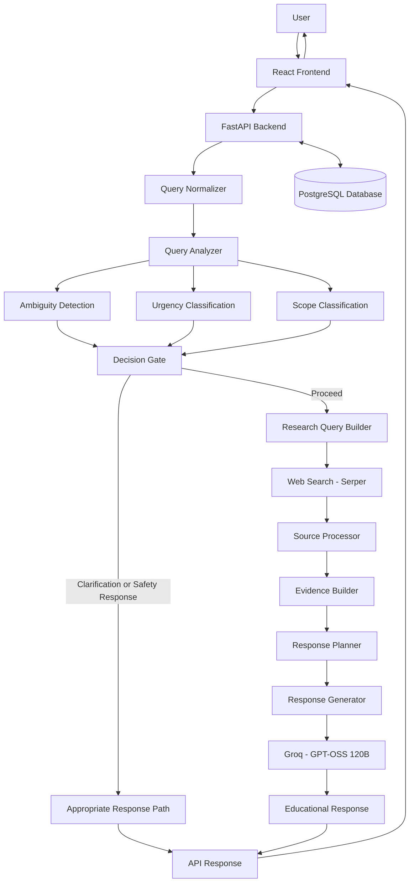

# CardioGuide AI ❤️

### Understand your heart health, one conversation at a time.

**CardioGuide AI is an AI-powered cardiovascular health education assistant designed to make reliable heart-health information easier to understand through natural conversation, web-supported research, evidence-grounded responses, and safety-aware question handling.**

<p align="center">
  <a href="https://cardio-guid.lovable.app/">
    
  </a>
  <a href="https://cardio-guide-ai.onrender.com/health">
    
  </a>
</p>

<p align="center">
  <a href="https://cardio-guid.lovable.app/">Live Application</a> ·
  <a href="https://cardio-guide-ai.onrender.com">Backend API</a> ·
  <a href="https://cardio-guide-ai.onrender.com/health">API Health</a> ·
  <a href="https://github.com/Rbolarinwa-DS">GitHub Profile</a>
</p>

<p align="center">
  
  
  
  
  
  
</p>

---

## Table of Contents

- [Live Demo and Screenshots](#live-demo-and-screenshots)
- [Project Overview](#project-overview)
- [The Problem](#the-problem)
- [Project Objectives](#project-objectives)
- [Key Features](#key-features)
- [How CardioGuide AI Works](#how-cardioguide-ai-works)
- [System Architecture](#system-architecture)
- [Technology Stack](#technology-stack)
- [Backend API](#backend-api)
- [Database and Conversation Persistence](#database-and-conversation-persistence)
- [Project Structure](#project-structure)
- [Getting Started](#getting-started)
- [Environment Variables](#environment-variables)
- [Running the Application](#running-the-application)
- [Testing and Quality Assurance](#testing-and-quality-assurance)
- [Safety, Scope, and Limitations](#safety-scope-and-limitations)
- [Current Project Status](#current-project-status)
- [Future Improvements](#future-improvements)
- [Author](#author)

---

## Live Demo and Screenshots

### Try the application

**[Launch CardioGuide AI →](https://cardio-guid.lovable.app/)**

The application connects a conversational frontend to a Python backend that coordinates question analysis, web research, evidence processing, language-model generation, and response delivery.

- **Frontend:** [cardio-guid.lovable.app](https://cardio-guid.lovable.app/)
- **Backend API:** [cardio-guide-ai.onrender.com](https://cardio-guide-ai.onrender.com)
- **Health endpoint:** [Check API health](https://cardio-guide-ai.onrender.com/health)

The availability of the frontend does not, by itself, guarantee that every backend dependency or AI request is operational.

### Application screenshots

#### 1. Landing page

The landing page introduces CardioGuide AI and its focus on accessible cardiovascular health education.


#### 2. Conversational AI interface

The chat interface provides the primary user experience for asking cardiovascular health questions and receiving educational responses.


#### 3. Additional application view

An additional view of the application's interface.


> **Screenshot paths:** These image links assume that the root `README.md` is in the repository root and that the files exist under `phase_1_research_engine/pictures/`. GitHub paths are case-sensitive. If the README is inside `phase_1_research_engine/`, change the image paths to `pictures/landing.png`, `pictures/chat.png`, and `pictures/extra.png`.

---

## Project Overview

CardioGuide AI is a conversational AI project focused on cardiovascular health education.

Instead of treating every question as a simple prompt to a language model, the backend is organized as a research and response pipeline. It analyzes the user's question, determines its likely intent and scope, prepares research queries, retrieves relevant web information, processes available evidence, and generates an educational response.

The system also incorporates safety-oriented decision-making to help distinguish routine educational questions from ambiguous or potentially urgent health-related messages.

The goal is to build a more structured, explainable, and maintainable AI application than a basic chatbot that sends a user's message directly to a large language model.

### What makes the project interesting?

CardioGuide AI brings together several areas of applied software engineering and AI:

- **Natural language processing:** Interpreting informal, misspelled, or medically phrased questions.
- **Information retrieval:** Converting user questions into research queries and retrieving relevant web information.
- **Evidence processing:** Organizing retrieved information into a structured representation for response generation.
- **Large language models:** Generating readable, conversational explanations from available evidence.
- **Safety-aware routing:** Evaluating the scope and urgency of health-related messages before proceeding.
- **Backend engineering:** Exposing the research workflow through a FastAPI service.
- **Database integration:** Supporting persistent user and conversation data.
- **Deployment:** Connecting a hosted frontend to a separately deployed backend and managed database.

CardioGuide AI is an educational prototype, not a diagnostic system or a substitute for professional medical care.

---

## The Problem

Cardiovascular health information is widely available, but finding, understanding, and interpreting it can be difficult.

Users may encounter:

- Medical terminology that is difficult to understand.
- Information spread across multiple websites.
- Conflicting or poorly contextualized health claims.
- Generic chatbot answers that do not clearly distinguish evidence from generated explanation.
- Difficulty recognizing when a question describes a potentially urgent situation.

A conventional chatbot may produce a fluent answer without sufficiently grounding it in retrieved information. A search engine may return useful pages but leave the user to interpret them independently.

CardioGuide AI explores an intermediate approach: combine conversational interaction with a structured research workflow and explicit safety considerations.

## Project Objectives

The project is designed to:

1. Make cardiovascular health education more accessible through natural conversation.
2. Improve the interpretation of user questions before research begins.
3. Retrieve relevant information for supported questions using web search.
4. Organize retrieved material into evidence that can support response generation.
5. Generate understandable answers that remain within the educational scope of the application.
6. Introduce safety-aware routing for ambiguous and potentially urgent health questions.
7. Provide a backend architecture that can be tested, maintained, and extended.
8. Support persistent conversation data through a relational database.
9. Demonstrate how AI, retrieval, APIs, databases, and deployment fit together in a complete application.

---

## Key Features

### 1. Conversational cardiovascular education

Users can ask questions about cardiovascular health in natural language rather than needing to formulate a formal medical search query.

The intended experience supports questions about topics such as blood pressure, cardiovascular risk factors, symptoms, prevention, and general heart-health education.

The quality and coverage of answers depend on the implemented research pipeline, available evidence, model behavior, and external service availability.

### 2. Query normalization

User questions may contain spelling errors, abbreviations, slang, informal wording, or inconsistent terminology.

The query-normalization component helps standardize these inputs before downstream analysis and research.

The intended pipeline uses deterministic normalization where possible, with more expensive language-model assistance available where configured and needed. This approach aims to reduce unnecessary model calls while retaining the meaning of the original question.

Normalization must remain conservative: correcting wording should not silently change a potentially important medical detail.

### 3. Intent and topic analysis

Before research and generation, the backend analyzes the question to help determine what the user is asking.

This supports the distinction between different kinds of requests, such as general explanations, questions about symptoms, and questions that may need clarification or urgent guidance.

### 4. Research query construction

A user's original wording is not always the best search query.

The research-query builder transforms the analyzed question into search-oriented queries intended to retrieve relevant information from the web.

This separates the user's conversational wording from the terms used internally to find supporting material.

### 5. Web-supported research

CardioGuide AI uses Serper for web search.

Retrieved results provide material for the subsequent evidence-processing stages. The value of this step depends on the relevance, quality, currency, and reliability of the returned sources.

Search results are not automatically authoritative simply because they were retrieved successfully.

### 6. Evidence construction

The evidence-processing pipeline organizes relevant information before it is passed to the response-generation stage.

The architecture is designed to consider cardiovascular topics such as:

- Symptoms
- Causes
- Risk factors
- Diagnosis and clinical evaluation
- Complications
- Prevention
- Management and treatment
- Types of cardiovascular conditions
- Monitoring
- Lifestyle
- When to seek medical help

The available evidence determines which topics can be addressed responsibly in a particular answer. The presence of a topic in the architecture does not mean every response will contain information about it.

### 7. Evidence-grounded response generation

CardioGuide AI uses Groq-hosted GPT-OSS 120B for language-model response generation, as configured for the project.

The response-generation stage is intended to transform processed evidence into a clear explanation suitable for a conversational interface.

Keeping generation separate from research and safety logic makes it easier to inspect the workflow, test components independently, and improve response quality without placing every responsibility inside one large prompt.

### 8. Safety-aware decision-making

Health-related questions need more careful handling than ordinary informational requests.

CardioGuide AI includes components for evaluating ambiguity, urgency, and scope, alongside a decision gate that helps determine how a request should proceed.

These components are intended to support safer routing. They should not be interpreted as a guarantee that the system will identify every emergency or correctly assess every medical scenario.

### 9. Persistent conversation data

The backend integrates with PostgreSQL for application data and conversation-related records.

This provides a foundation for retaining conversations and associating messages with users or conversation identifiers, where the relevant routes and database operations are implemented and available.

Database persistence is separate from model context: storing a conversation does not automatically mean every previous message is correctly retrieved or used in future responses.

### 10. REST API

FastAPI exposes the backend functionality through HTTP endpoints.

This separation allows the frontend and backend to be developed and deployed independently, while also making it possible to test backend behavior without interacting with the graphical interface.

### 11. Deployable architecture

The application uses a hosted frontend, a separately hosted backend, and a managed PostgreSQL database.

Docker configuration is also included in the backend project to support a reproducible containerized environment.

---

## How CardioGuide AI Works

The application is organized into stages so that each part has a clear responsibility.

### Step-by-step request lifecycle

**Step 1 — User submits a question**

The frontend sends the user's cardiovascular health question to the backend API.

**Step 2 — Query normalization**

The query normalizer standardizes wording where appropriate while attempting to preserve the meaning of the original question.

**Step 3 — Question analysis**

The query analyzer evaluates the question's intent and topic. Related safety components assess its scope, ambiguity, and potential urgency.

**Step 4 — Decision and routing**

The decision gate determines the appropriate path through the workflow based on the information produced by the preceding components.

A question that requires clarification or urgent guidance should not simply be treated as an ordinary research request.

**Step 5 — Research query construction**

For questions that proceed to research, the research-query builder prepares queries suitable for the web-search stage.

**Step 6 — Web retrieval**

The web-search component uses Serper to retrieve potentially relevant information.

**Step 7 — Source processing**

The source processor handles the retrieved results, preparing the available source material for evidence construction.

**Step 8 — Evidence construction and planning**

The evidence builder organizes relevant claims and information. The response planner determines how the available evidence should support the answer.

**Step 9 — Response generation**

The response generator uses the configured language model to produce a readable answer from the information provided to it.

**Step 10 — Response delivery**

The backend returns the result to the frontend for presentation to the user.

The exact path depends on the request and the behavior of the safety and decision components. Not every request should necessarily execute every stage.

---

## System Architecture

The following diagram illustrates the logical architecture of the application.



*This is a logical overview, not a guarantee that every request follows an identical execution path. The actual implementation determines the precise ordering and dependencies.*

### Separation of responsibilities

The architecture separates several responsibilities that are often combined in simple LLM applications:

| Component | Primary responsibility |
|---|---|
| Query normalizer | Standardize user wording |
| Query analyzer | Interpret the question and its likely intent |
| Ambiguity detector | Identify questions that may need clarification |
| Urgency classifier | Evaluate signals of potential urgency |
| Scope classifier | Assess whether a request fits the application's intended scope |
| Decision gate | Route the request based on preceding analysis |
| Research query builder | Prepare web-search queries |
| Web searcher | Retrieve potentially relevant web results |
| Source processor | Process retrieved source material |
| Evidence builder | Organize supporting evidence |
| Response planner | Structure the intended answer |
| Response generator | Produce a readable response from the supplied material |
| FastAPI application | Expose functionality through HTTP endpoints |
| PostgreSQL | Persist supported application records |

The separation improves maintainability and makes component-level testing possible. It does not, by itself, establish that the entire system is reliable or clinically safe.

---

## Technology Stack

### Frontend

| Technology | Purpose |
|---|---|
| React | Component-based user interface |
| TypeScript | Static typing for frontend code |
| Tailwind CSS | Utility-based interface styling |
| Lovable | Frontend development and hosting workflow |

### Backend and AI

| Technology | Purpose |
|---|---|
| Python | Backend implementation and orchestration |
| FastAPI | REST API framework |
| Uvicorn | ASGI server |
| Groq | Hosted language-model inference |
| GPT-OSS 120B | Configured language model for response generation |
| Serper | Web-search integration |

### Data and deployment

| Technology | Purpose |
|---|---|
| PostgreSQL | Relational data storage |
| Neon | Managed PostgreSQL hosting |
| SQLAlchemy | Database interaction and ORM support |
| Docker | Containerized backend environment |
| Render | Backend hosting |
| Git and GitHub | Version control and source-code hosting |

The technology stack reflects the project's intended implementation. Exact installed versions and deployment configuration should be checked against the repository's dependency files and deployment settings.

---

## Backend API

The backend exposes HTTP endpoints through FastAPI.

### API endpoints

| Method | Endpoint | Purpose |
|---|---|---|
| `GET` | `/` | Root endpoint and basic application information |
| `GET` | `/health` | Health-check endpoint |
| `POST` | `/chat` | Submit a question to the conversational backend |
| `GET` | `/conversations/{conversation_id}` | Retrieve a conversation, if implemented in the current deployment |
| `GET` | `/users/{user_id}/conversations` | Retrieve a user's conversations, if implemented in the current deployment |

The conversation-retrieval endpoints should be checked against `api/main.py` and the deployed API before being treated as available public routes.

### Example chat request

The `/chat` endpoint accepts a JSON request containing a question, with optional user and conversation identifiers.

```http
POST /chat
Content-Type: application/json
```

```json
{
  "question": "What does high blood pressure mean?",
  "user_id": "example-user-id",
  "conversation_id": "example-conversation-id"
}
```

The identifiers above are placeholders. Use identifiers in the format expected by the actual application.

A minimal request may omit the optional identifiers:

```json
{
  "question": "What is blood pressure?"
}
```

### Try the deployed API

- [Backend root](https://cardio-guide-ai.onrender.com)
- [Health check](https://cardio-guide-ai.onrender.com/health)
- [Interactive API documentation](https://cardio-guide-ai.onrender.com/docs)

The FastAPI documentation page is available if the deployed service exposes the default OpenAPI documentation route.

**Important:** A successful health check confirms only what that endpoint actually checks. It does not necessarily verify language-model access, web search, database operations, evidence quality, or emergency-handling behavior.

---

## Database and Conversation Persistence

CardioGuide AI uses PostgreSQL to provide structured data storage.

The database layer supports the application's user and conversation-related functionality, depending on the models, migrations, and operations implemented in the current version.

The project documentation identifies the following data areas:

| Data area | Purpose |
|---|---|
| Users | Associate application activity with user identifiers |
| User profiles | Store supported user-related profile information |
| Conversations | Represent individual conversation sessions |
| Messages | Store messages associated with conversations |

These are logical descriptions of the project's data model. The exact schema, column names, relationships, constraints, and migration history are defined by the database implementation.

### Why persistent storage matters

Persistence provides a foundation for:

- Retrieving earlier conversations.
- Associating messages with the correct conversation.
- Supporting continuity across interactions.
- Building future conversation-management functionality.

Persistent storage must be paired with appropriate authorization and access controls. A user identifier alone should not be treated as proof that a requester is authorized to read another user's data.

Because the application handles health-related questions, database access, logging, secrets, and retained conversation data should be managed with privacy in mind.

---

## Project Structure

The following is a conceptual guide to the repository. Confirm individual filenames against the actual project before using this as a literal directory listing.

```text
Cardio-Guide-AI/
│
├── README.md
│
└── phase_1_research_engine/
    │
    ├── api/
    │   ├── main.py
    │   ├── schemas.py
    │   └── ...
    │
    ├── query_engine/
    │   ├── normalizer.py
    │   ├── ...
    │   └── ...
    │
    ├── data/
    │   └── ...
    │
    ├── tests/
    │   └── ...
    │
    ├── pictures/
    │   ├── landing.png
    │   ├── chat.png
    │   └── extra.png
    │
    ├── Dockerfile
    ├── docker-compose.yml
    ├── requirements.txt
    ├── .dockerignore
    ├── .gitignore
    └── .env
```

### Main directories and files

- **`api/`** — FastAPI application entry point, request and response schemas, and API-related functionality.
- **`query_engine/`** — Question normalization, analysis, research, evidence construction, safety routing, and response-generation components.
- **`data/`** — Local datasets or other data files required by the application.
- **`tests/`** — Automated tests for supported components and behaviors.
- **`pictures/`** — Screenshots used to document the application in this README.
- **`Dockerfile`** — Instructions for building the backend container image.
- **`docker-compose.yml`** — Configuration for running configured services together.
- **`requirements.txt`** — Python dependencies.
- **`.env`** — Local environment variables and secrets; it must not be committed with real credentials.

The ellipses (`...`) indicate omitted files and directories, not literal filenames.

---

## Getting Started

Follow these steps to run the backend locally.

### Prerequisites

Install or prepare:

- Python 3.11 or a compatible version supported by the project.
- Git.
- Access to the repository.
- A PostgreSQL database configured for the application.
- A Groq API key.
- A Serper API key.
- The project's required Python dependencies.

The deployed frontend and backend are separate services. Running the backend locally does not automatically start the hosted frontend or reproduce the complete production environment.

### 1. Clone the repository

```bash
git clone https://github.com/Rbolarinwa-DS/Cardio-Guide-AI.git
cd Cardio-Guide-AI
```

### 2. Navigate to the backend project

```bash
cd phase_1_research_engine
```

### 3. Create a virtual environment

**Windows PowerShell**

```powershell
python -m venv .venv
.\.venv\Scripts\Activate.ps1
```

If PowerShell prevents activation, use a permitted activation method for your environment rather than weakening your system's security settings unnecessarily.

**macOS or Linux**

```bash
python3 -m venv .venv
source .venv/bin/activate
```

### 4. Install dependencies

```bash
python -m pip install --upgrade pip
python -m pip install -r requirements.txt
```

### 5. Configure environment variables

Create a local `.env` file in the location expected by the application and populate the required variables.

At minimum, the documented configuration includes:

```dotenv
DATABASE_URL=your_postgresql_connection_string
GROQ_API_KEY=your_groq_api_key
SERPER_API_KEY=your_serper_api_key
```

These are placeholders, not working credentials.

The application may require additional variables depending on the current configuration. Check the settings code and deployment environment before assuming this list is exhaustive.

### 6. Start the backend

From inside `phase_1_research_engine/`, run:

```bash
python -m uvicorn api.main:app --reload
```

Using `python -m uvicorn` helps ensure Uvicorn runs under the active Python environment.

The backend should be available locally at:

- API root: `http://127.0.0.1:8000/`
- Health check: `http://127.0.0.1:8000/health`
- Interactive API docs: `http://127.0.0.1:8000/docs`

Keep the terminal open while the server is running. If startup fails, inspect the error message, environment configuration, dependency versions, and database connectivity.

---

## Environment Variables

The backend uses environment variables to separate configuration and credentials from source code.

| Variable | Purpose |
|---|---|
| `DATABASE_URL` | Connection string for the configured PostgreSQL database |
| `GROQ_API_KEY` | Credential for the Groq language-model API |
| `SERPER_API_KEY` | Credential for the Serper search API |

Additional variables may be used for database settings, provider configuration, or deployment behavior. Consult the current application configuration for the complete list.

### Security practices

- Never commit real API keys, passwords, or database credentials.
- Keep `.env` out of Git.
- Use separate credentials for local development and hosted deployments where practical.
- Store production secrets in the hosting provider's environment settings.
- Avoid logging secrets or full sensitive connection strings.
- Restrict database permissions to the operations the application requires.
- Rotate any credential that has accidentally been exposed.

Do not paste real secrets into issues, screenshots, public documentation, or commit messages.

---

## Running with Docker

The repository includes Docker-related configuration for the backend.

Before running containers, verify that Docker is installed and that the Compose configuration points to the correct environment variables, database, and service names.

From the directory containing `docker-compose.yml`, start the configured services with:

```bash
docker compose up --build
```

To run them in the background:

```bash
docker compose up --build -d
```

To inspect service status:

```bash
docker compose ps
```

To inspect logs:

```bash
docker compose logs -f
```

To stop the services:

```bash
docker compose down
```

The commands above assume the Compose file defines the relevant services and mappings. A local database, an externally hosted database, or a separately running PostgreSQL instance may require different configuration.

**Database caution:** Do not remove persistent volumes or delete database data as a routine troubleshooting step. Understand the impact on stored data before running destructive commands.

---

## Testing and Quality Assurance

CardioGuide AI contains multiple stages, so testing only whether the server starts is insufficient.

Testing should cover individual components, API integration, data persistence, error handling, and end-to-end behavior.

### Recommended testing layers

#### 1. Component tests

Test components independently to verify that they behave as expected.

Examples include:

- Query normalization preserves the intended meaning.
- Research queries are constructed from the analyzed question.
- Evidence construction handles empty or insufficient source results.
- Response planning handles missing evidence.
- The response generator does not invent support that is absent from its supplied evidence.
- Safety-related components classify representative test cases appropriately.

#### 2. API tests

Verify that endpoints:

- Accept valid requests.
- Reject invalid inputs appropriately.
- Return predictable response structures.
- Handle missing or malformed data gracefully.
- Report dependency failures without exposing secrets or internal implementation details.

#### 3. Integration tests

Test the interaction between:

- The FastAPI layer and the research pipeline.
- The application and PostgreSQL.
- The application and the web-search provider.
- The application and the language-model provider.
- Conversation creation, storage, and retrieval.

Tests that require external providers should distinguish provider outages or rate limits from application logic failures.

#### 4. End-to-end tests

Test realistic user journeys, from submitting a question to receiving the final answer in the frontend.

Include cases where the research provider returns no useful results, the model times out, or the database is unavailable.

#### 5. Safety and regression tests

Health-related applications require explicit regression cases for high-risk and ambiguous requests.

Examples include:

- General educational questions.
- Misspelled or abbreviated medical terms.
- Questions with insufficient context.
- Questions describing potentially urgent symptoms.
- Requests outside the application's intended scope.
- Questions for which retrieved evidence is insufficient or contradictory.

A particularly important test category is whether potentially urgent symptoms are routed to appropriate immediate safety guidance rather than being treated as ordinary research questions.

### Running the test suite

If the project uses pytest and its test configuration supports it, run the tests from the backend project directory:

```bash
python -m pytest
```

To obtain more detailed output:

```bash
python -m pytest -v
```

The exact test commands may depend on the repository's configuration and dependencies.

A passing test suite is useful evidence of the tested behavior, but it does not establish clinical validity, eliminate hallucinations, or guarantee that all emergencies will be recognized.

---

## Safety, Scope, and Limitations

CardioGuide AI is designed for **cardiovascular health education, not diagnosis or treatment decisions**.

This distinction is fundamental to the project.

### Educational use only

The application is intended to explain health concepts and help users understand cardiovascular information. It is not a medical device and should not be used as a substitute for a qualified healthcare professional.

### No guarantee of medical accuracy

Language models can generate incorrect, incomplete, outdated, or misleading information. Retrieved web pages may also be unreliable, irrelevant, or inconsistent with one another.

The presence of a source or a fluent explanation does not automatically make an answer medically correct.

### Emergency handling requires rigorous validation

An urgency classifier can help route potentially concerning questions, but it can also miss warning signs or misinterpret a message.

A real-world medical emergency must not depend on a chatbot correctly classifying the user's message. Anyone experiencing potentially life-threatening symptoms should seek emergency medical assistance immediately rather than waiting for an AI response.

### Evidence limitations

Research quality depends on search results, source processing, evidence selection, and how faithfully the response generator uses the supplied material.

When reliable supporting evidence is unavailable, the system should communicate its limitations rather than manufacture a confident answer.

### Privacy and security

Health-related conversations can contain sensitive information. Data collection, retention, access controls, and logging should be designed accordingly.

The existence of a database does not, by itself, establish compliance with healthcare privacy laws or other regulatory requirements.

### Not clinically validated

CardioGuide AI is an engineering and AI education project. It has not been established as clinically validated or approved for diagnostic or treatment use.

Before any real-world healthcare deployment, it would require substantially more rigorous medical review, safety evaluation, privacy and security assessment, and regulatory analysis.

---

## Current Project Status

CardioGuide AI combines a conversational frontend with a backend research pipeline, AI-powered response generation, and database integration.

The project also has deployed frontend and backend URLs, but deployments and dependencies can change over time.

| Area | Documented status |
|---|---|
| Conversational frontend | Deployed on Lovable |
| Python API | Deployed on Render |
| Web-search integration | Serper integration |
| Language-model integration | Groq with GPT-OSS 120B configured |
| Database | Neon PostgreSQL integration |
| Containerization | Docker configuration included |
| Query and evidence pipeline | Implemented as modular backend components |
| Safety-aware routing | Implemented components; requires ongoing regression testing |
| Clinical validation | Not established |
| Production medical readiness | Not claimed |

The status table describes the documented project state, not a live verification of every service or a guarantee that every feature works under all conditions.

---

## Future Improvements

Potential next steps include the following.

### 1. Stronger evidence quality controls

Improve source-quality evaluation, source diversity, freshness checks, claim-to-source alignment, and handling of contradictory information.

### 2. Better answer traceability

Make it easier to determine which retrieved sources support specific statements in an answer and to detect unsupported claims before a response is delivered.

### 3. Expanded regression testing

Build a comprehensive, repeatable evaluation set covering common questions, ambiguous requests, misspellings, empty search results, provider failures, and high-risk scenarios.

### 4. More reliable safety routing

Improve and rigorously test the handling of urgent symptoms, including conservative behavior when important information is ambiguous or incomplete.

### 5. Conversation continuity

Strengthen conversation retrieval, contextual follow-up handling, ownership checks, and the separation between stored conversation history and information passed to the model.

### 6. Better observability

Introduce structured logging, request tracing, latency monitoring, and clear error categories without exposing credentials or unnecessarily retaining sensitive health information.

### 7. Deployment and reliability improvements

Add automated checks, repeatable deployment workflows, dependency management, and monitoring for external API failures and database connectivity.

### 8. Expanded educational modules

Potential additions include:

- Blood pressure education.
- Cholesterol education.
- Cardiovascular disease reference material.
- Lifestyle and prevention guidance.
- General medication education.
- Medical-report terminology explanations.

These are future expansion areas unless the corresponding functionality has already been implemented and tested.

---

## Author

**Built by Rbolarinwa-DS**

Computer Science student exploring the intersection of AI engineering, backend development, information retrieval, and practical AI applications.

- GitHub: [@Rbolarinwa-DS](https://github.com/Rbolarinwa-DS)
- Project repository: [Cardio-Guide-AI](https://github.com/Rbolarinwa-DS/Cardio-Guide-AI)
- Live project: [CardioGuide AI](https://cardio-guid.lovable.app/)

---

## Disclaimer

CardioGuide AI is an educational software project. It is not intended to diagnose, prevent, treat, or cure any disease, and it does not replace professional medical advice, diagnosis, or treatment.

Information provided by the application may be inaccurate or incomplete. Do not delay seeking professional care because of something the application says. For a medical emergency, contact local emergency services immediately.

---

<p align="center">
  <strong>CardioGuide AI</strong><br />
  Making cardiovascular health information easier to explore, understand, and discuss.
</p>
